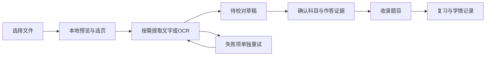

# 文件导入与学习成长：重新设计方案

本次已实现手机端答案转移修复：保留原生选区、提供点选起止文字的替代操作、可撤销移动、明确按钮样式。下面的导入任务、知识点归并与复习调度为下一步设计，尚未作为已可用功能发布。

## 页面结构

保持四个主导航与现有系统：录题、错题本、题库、设置。

- 录题：拍照／选图继续使用现有流程；新增文件导入入口时，先展示文件、页数和选页，不立即调用 OCR 或 AI。
- 错题本：保留科目卡片；在实际题目旁显示来源页、知识点、复习到期状态。批量整理和重复题提示在这里处理。
- 题库：保留共享资源和按需导入；规范知识点目录连接题库与个人错题，来源与许可继续保留。
- 学习记录：扩展现有学习记录面板，显示待复习知识点、独立作答与辅助作答的区别、反复出错记录。

## 导入任务中心

第一阶段：PDF、多张图片和纯文本；随后再适配 DOCX、XLSX/CSV、兼容 JSON。带复杂版式的文件必须保留原图位置与校对入口。

任务页面包含：文件与页数、已选页、预览、预计 OCR 调用量、开始／暂停、成功／失败计数、失败原因、只重试失败项。处理结果先进入草稿区，不直接变成孩子的错题或掌握记录。

文字 PDF 优先本地提取文字；扫描页和需要图像的内容才按选页调用 OCR。初版建议一次最多处理20页、每批最多确认60题，限制可根据实测调整。暂停后从已完成页继续；重试不重复写入已确认题目。

## 手机校对交互

原题下方使用带图标、边框和底色的“选文字作为孩子作答”按钮。长按选择有效文字后可以直接移动；没有原生选区时，打开点选弹窗，点击起点与终点选择范围，单字点一次即可。

弹窗显示当前选择预览；长题分段展示。确认后从原题移出该范围，替换为空位，并放入孩子作答。选择题转换为实际选项，填空题进入第一个空位，其他题追加文字。提供撤销；继续编辑后的旧撤销不覆盖新改动。转移和撤销均要求重新人工核对，不产生 AI 调用。

## 成长记录

| 记录 | 更新方式 | 后续用途 |
| --- | --- | --- |
| 规范知识点与别名 | AI建议、人工确认、版本化归并 | 合并“行程问题”等同义标签，动态提供筛选与出题目录 |
| 校对差异 | 保存原始转录、人工修订、原图位置及确认状态 | 对同类版式或疑似误识提出提示；保留孩子原始错误 |
| 复习表现 | 记录每次实际作答、核对结果、是否看过答案、自评 | 生成到期复习队列、发现复发错误 |
| 重复题关联 | 本地提示候选、人工关联 | 同题多次作答纵向追踪，不覆盖历史答案 |

模型本身不自动重新训练。成长体现为这些可追溯的数据与规则持续更新。AI仅提出候选标签和建议，不自行改写已保存原题，也不能仅根据“自评掌握”推断实际掌握。

## 沿用现有数据和费用边界

原文件先在本机保留；私人D1继续保存结构化题目、必要裁剪图、练习与新增成长记录。任务与候选标签可沿用现有带版本、冲突保护和删除记录的同步方式，先设计可选集合，不更换存储服务。

每个任务保留文件指纹、来源页、完成状态、草稿编号、确认编号与错误原因。校对记录关联题目和来源，不把整份文件反复附进AI请求。

继续遵守现有摘要上限：最多3个相关知识点、2条历史例子、固定长度预算。只有用户明确开始识别、分析或出题才调用收费服务；任务处理页显示调用范围，不在后台扫描全部资料。

## 实施顺序与验收

1. 导入任务中心：选页准确、草稿可恢复、暂停重试不丢题、不重复确认，原图与来源可追溯。
2. 规范知识点与校对记录：别名可合并、候选需确认、原文与原始作答保留，修改可追溯。
3. 复习闭环：独立作答与辅助作答分开统计，到期队列可解释，复发错误能关联历史，AI摘要预算不随题量增长。
